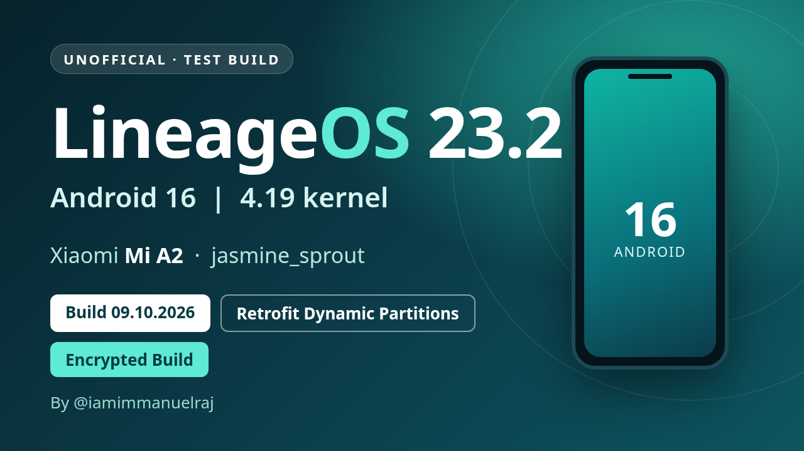

# LineageOS 23.2 (Android 16) - Xiaomi Mi A2 (jasmine_sprout) - 09.10.2026

**UNOFFICIAL test build - Encrypted build (file-based encryption, AES-256-XTS) - Build date 09.10.2026**

> **Superseded by the [17.10.2026 build](../20261017/README.md).**
>
> Experimental. Needs an unlocked bootloader. Known issues: mobile network / SIM not detected, double tap to wake, fingerprint and Widevine are not working yet.

## Build identifiers

| | |
| --- | --- |
| Android / ROM | Android 16, LineageOS 23.2 (no Google apps included) |
| Build type | **userdebug** build, **test-keys** signed |
| SELinux | **Enforcing** |
| Verified boot | none (no dm-verity in this build) |
| Kernel | **4.19** (Mi A2 4.19 kernel, branch fourteen-a16) |
| Partitions | A/B with **retrofit dynamic partitions** (super = system + vendor); `super_empty.img` needed on first install |
| Filesystems | **EROFS** (lz4) for system, vendor, product, system_ext, odm; f2fs for data |
| Encryption | File-based encryption v2 (AES-256-XTS) |
| Haptics | **QTI haptics** (QTI vibrator HAL) |

## Downloads

**[Release page (all files)](https://github.com/iamimmanuelraj/AOSP/releases/tag/lineageos-23.2-jasmine_sprout-20261009)**

| File | Use |
| --- | --- |
| [lineage-23.2-20261009-UNOFFICIAL-jasmine_sprout.zip](https://github.com/iamimmanuelraj/AOSP/releases/download/lineageos-23.2-jasmine_sprout-20261009/lineage-23.2-20261009-UNOFFICIAL-jasmine_sprout.zip) | The ROM (sideload from recovery) |
| [recovery-lineage-23.2-20261009-jasmine_sprout.img](https://github.com/iamimmanuelraj/AOSP/releases/download/lineageos-23.2-jasmine_sprout-20261009/recovery-lineage-23.2-20261009-jasmine_sprout.img) | Recovery image (this device uses recovery-as-boot, so it is flashed to `boot`) |
| [super_empty-lineage-23.2-jasmine_sprout.img](https://github.com/iamimmanuelraj/AOSP/releases/download/lineageos-23.2-jasmine_sprout-20261009/super_empty-lineage-23.2-jasmine_sprout.img) | Empty super image for the retrofit dynamic partitions (first install only) |
| [SHA256SUMS](https://github.com/iamimmanuelraj/AOSP/releases/download/lineageos-23.2-jasmine_sprout-20261009/SHA256SUMS) | Checksums for the three files above |
| [copy-partitions-20210323_1922.zip](https://github.com/PixelExperience-Devices/blobs/raw/main/copy-partitions-20210323_1922.zip) | Makes the firmware partitions consistent (once per device, from PixelExperience-Devices/blobs) |

Verify your downloads (all files in one folder): `sha256sum -c SHA256SUMS`

## Flashing instructions

Mi A2 uses **retrofit dynamic partitions**, so the install follows the same procedure as the [PixelExperience Mi A2 install guide](https://wiki.pixelexperience.org/devices/jasmine_sprout/install/), with the files above.

**Before you start**

1. Read all the steps once. Stop if any step fails.
2. Install `adb` and `fastboot` (fastboot 31.0.2 or newer).
3. Enable USB debugging. Back up your data: the bootloader unlock and the data format below erase everything.
4. The device should be on the latest stock Android 10 firmware.
5. Unlock the bootloader if it is still locked (once per device): enable OEM unlock, `adb reboot bootloader`, then `fastboot oem unlock`.

**1. Flash the recovery**

1. `adb reboot bootloader` (or power off and hold Volume Down + Power).
2. `fastboot flash boot recovery-lineage-23.2-20261009-jasmine_sprout.img`
   - If fastboot reports a `boot__a`/`boot__b` slot name, update fastboot, or flash to the slot it names (e.g. `boot_a`).
3. Reboot into recovery: power off, hold Volume Up + Power until the logo appears, and keep Volume Up held after releasing Power.

**2. Make firmware partitions consistent (once per device)**

1. In recovery choose **Apply update > Apply from ADB**.
2. `adb sideload copy-partitions-20210323_1922.zip`
3. In recovery choose **Advanced > Reboot to recovery**.

**3. Flash super_empty.img (first installation only)**

1. In recovery choose **Advanced > Enter fastboot** (you must be in fastbootd, not the normal bootloader).
2. `fastboot wipe-super super_empty-lineage-23.2-jasmine_sprout.img`

**4. Install LineageOS**

1. Back in recovery choose **Factory reset > Format data / factory reset** and continue. This is required because the build is encrypted; it deletes internal storage.
2. Go back to the main menu, choose **Apply update > Apply from ADB**.
3. `adb sideload lineage-23.2-20261009-UNOFFICIAL-jasmine_sprout.zip`
   - A failure message around 47% such as "failed to read command" is usually harmless if the sideload otherwise completed.
4. When it finishes, go back and choose **Reboot system now**.

The first boot takes a few minutes. If it drops back to the bootloader or recovery, redo the steps above. If you installed to one slot, the other slot's OS stays untouched, so you can switch back with `fastboot --set-active=<a|b>`.

> These steps follow PixelExperience's retrofit-dynamic-partition procedure. The ROM was developed by sideloading to the second slot of a device that already ran another OS; the clean-install path above has not been run end to end on a fresh device yet.
