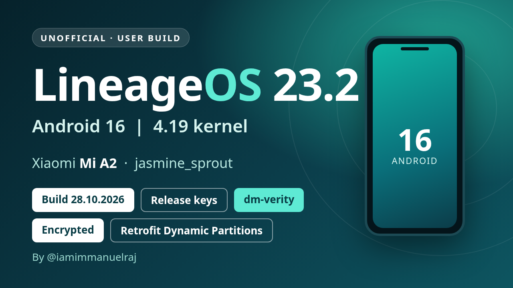

# LineageOS 23.2 (Android 16) - Xiaomi Mi A2 (jasmine_sprout) - 28.10.2026

**UNOFFICIAL - user build, release-keys signed - Encrypted build (file-based encryption, AES-256-XTS) - Build date 28.10.2026**

> **Bluetooth and GApps install fix:** on 17.10.2026 Bluetooth crashed at every start, and the GApps zip stopped with error 28 in recovery. This build fixes both, and it is synced with the latest LineageOS 23.2 source (security update shown in Settings: 1 October 2026).
>
> Needs an unlocked bootloader. Changelog: [CHANGELOG.md](../../CHANGELOG.md).
>
> Known issues: Widevine is Level 3 only; only the Goodix fingerprint sensor is supported for now. Have a unit with an FPC sensor? [Open an issue](https://github.com/iamimmanuelraj/AOSP/issues) and I'll add support.
>
> **Coming from 17.10.2026: no wipe needed**, see [Updating from 17.10.2026](#updating-from-17102026).
>
> **New install, or coming from 09.10.2026 or another ROM: ⚠️ clean flash required - all data will be lost.** You must format data, which erases everything on the phone: apps, settings, photos, downloads and the rest of internal storage. Back up first.

## Build identifiers

| | |
| --- | --- |
| Android / ROM | Android 16, LineageOS 23.2 - **Vanilla** (no Google apps) or **GApps** (MindTheGapps built in; not Play Store certified) |
| Build type | **user** build, **release-keys** signed |
| SELinux | **Enforcing** |
| Verified boot | **dm-verity** (AVB 2.0 hashtree on all dynamic partitions, signed vbmeta); bootloader stays unlocked |
| Kernel | **4.19** (LineageOS SDM660 kernel) |
| Partitions | A/B with **retrofit dynamic partitions** (super = system + vendor); `super_empty.img` needed on first install |
| Filesystems | **EROFS** (lz4) for system, vendor, product, system_ext, odm; f2fs for data |
| Encryption | File-based encryption v2 (AES-256-XTS) + metadata encryption |
| Haptics | **QTI haptics** (QTI vibrator HAL) |

## Downloads

**[Release page (all files)](https://github.com/iamimmanuelraj/AOSP/releases/tag/lineageos-23.2-jasmine_sprout-20261028)**

| File | Use |
| --- | --- |
| [lineage-23.2-20261028-UNOFFICIAL-jasmine_sprout.zip](https://github.com/iamimmanuelraj/AOSP/releases/download/lineageos-23.2-jasmine_sprout-20261028/lineage-23.2-20261028-UNOFFICIAL-jasmine_sprout.zip) | The ROM, **Vanilla** - no Google apps (sideload from recovery) |
| [lineage-23.2-20261028-UNOFFICIAL-jasmine_sprout-GAPPS.zip](https://github.com/iamimmanuelraj/AOSP/releases/download/lineageos-23.2-jasmine_sprout-20261028/lineage-23.2-20261028-UNOFFICIAL-jasmine_sprout-GAPPS.zip) | The ROM, **GApps** - MindTheGapps built in (sideload from recovery). Flashable GApps zips don't work on this ROM (EROFS + dm-verity), so pick this one if you want Google apps |
| [recovery-lineage-23.2-20261028-jasmine_sprout.img](https://github.com/iamimmanuelraj/AOSP/releases/download/lineageos-23.2-jasmine_sprout-20261028/recovery-lineage-23.2-20261028-jasmine_sprout.img) | Recovery image (this device uses recovery-as-boot, so it is flashed to `boot`); only needed for a new install |
| [super_empty-lineage-23.2-jasmine_sprout.img](https://github.com/iamimmanuelraj/AOSP/releases/download/lineageos-23.2-jasmine_sprout-20261028/super_empty-lineage-23.2-jasmine_sprout.img) | Empty super image for the retrofit dynamic partitions (first install only) |
| [SHA256SUMS](https://github.com/iamimmanuelraj/AOSP/releases/download/lineageos-23.2-jasmine_sprout-20261028/SHA256SUMS) | Checksums for all files above |
| [lineage-23.2-20261028-UNOFFICIAL-jasmine_sprout.zip.sha256](https://github.com/iamimmanuelraj/AOSP/releases/download/lineageos-23.2-jasmine_sprout-20261028/lineage-23.2-20261028-UNOFFICIAL-jasmine_sprout.zip.sha256), [lineage-23.2-20261028-UNOFFICIAL-jasmine_sprout-GAPPS.zip.sha256](https://github.com/iamimmanuelraj/AOSP/releases/download/lineageos-23.2-jasmine_sprout-20261028/lineage-23.2-20261028-UNOFFICIAL-jasmine_sprout-GAPPS.zip.sha256) | Checksum of each ROM zip |
| [copy-partitions-20210323_1922.zip](https://github.com/PixelExperience-Devices/blobs/raw/main/copy-partitions-20210323_1922.zip) | Makes the firmware partitions consistent (once per device, from PixelExperience-Devices/blobs) |

Verify your downloads (all files in one folder): `sha256sum -c SHA256SUMS`

## Updating from 17.10.2026

Same signing keys, so this installs over 17.10.2026 without losing data. Stay on the same variant (Vanilla or GApps).

1. With USB debugging on: `adb reboot sideload-auto-reboot` (or boot to recovery and choose **Apply update > Apply from ADB**).
2. `adb sideload lineage-23.2-20261028-UNOFFICIAL-jasmine_sprout.zip` (Vanilla) or `adb sideload lineage-23.2-20261028-UNOFFICIAL-jasmine_sprout-GAPPS.zip` (GApps)
3. The phone reboots by itself when it is done (with `sideload-auto-reboot`); otherwise choose **Reboot system now**.

If Bluetooth still stops after the update, clear its data once: Settings > Apps > See all apps > (menu) Show system > Bluetooth > Storage & cache > Clear storage.

## Flashing instructions (new install)

Mi A2 uses **retrofit dynamic partitions**, so the install follows the same procedure as the [PixelExperience Mi A2 install guide](https://wiki.pixelexperience.org/devices/jasmine_sprout/install/), with the files above.

**Before you start**

1. Read all the steps once. Stop if any step fails.
2. Install `adb` and `fastboot` (fastboot 31.0.2 or newer).
3. Enable USB debugging. Back up your data: the bootloader unlock and the data format below erase everything.
4. The device should be on the latest stock Android 10 firmware.
5. Unlock the bootloader if it is still locked (once per device): enable OEM unlock, `adb reboot bootloader`, then `fastboot oem unlock`.

**1. Flash the recovery**

1. `adb reboot bootloader` (or power off and hold Volume Down + Power).
2. `fastboot flash boot recovery-lineage-23.2-20261028-jasmine_sprout.img`
   - If fastboot reports a `boot__a`/`boot__b` slot name, update fastboot, or flash to the slot it names (e.g. `boot_a`).
3. Reboot into recovery: power off, hold Volume Up + Power until the logo appears, and keep Volume Up held after releasing Power.

**2. Make firmware partitions consistent (once per device)**

1. In recovery choose **Apply update > Apply from ADB**.
2. `adb sideload copy-partitions-20210323_1922.zip`
3. In recovery choose **Advanced > Reboot to recovery**.

**3. Flash super_empty.img (first installation only)**

1. In recovery choose **Advanced > Reboot to bootloader** (or run `fastboot reboot bootloader` / `adb reboot bootloader`).
   This must be the normal bootloader (`fastboot devices` shows `fastboot`), **not** recovery's "Enter fastboot" (fastbootd):
   in fastbootd, `wipe-super` fails with `Resizing 'vendor_b' FAILED (remote: 'Not enough space to resize partition')`.
2. `fastboot wipe-super super_empty-lineage-23.2-jasmine_sprout.img`
   - Don't add `--slot=all`: the Mi A2 bootloader stops with `Could not check if partition vendor has slot all`.
   - Expected output: `Writing 'system_b' OKAY`, `Writing 'vendor' OKAY` (vendor is 0 KB, that's normal), `Finished`.
3. Boot back into recovery: power off, hold Volume Up + Power.

**4. Install LineageOS**

1. In recovery choose **Factory reset > Format data / factory reset** and continue. This is required because the build is encrypted; it deletes internal storage.
2. Go back to the main menu, choose **Apply update > Apply from ADB**.
3. `adb sideload lineage-23.2-20261028-UNOFFICIAL-jasmine_sprout.zip` (Vanilla) or `adb sideload lineage-23.2-20261028-UNOFFICIAL-jasmine_sprout-GAPPS.zip` (GApps)
4. When it finishes, go back and choose **Reboot system now**.

The first boot takes a few minutes. If it drops back to the bootloader or recovery, redo the steps above.

