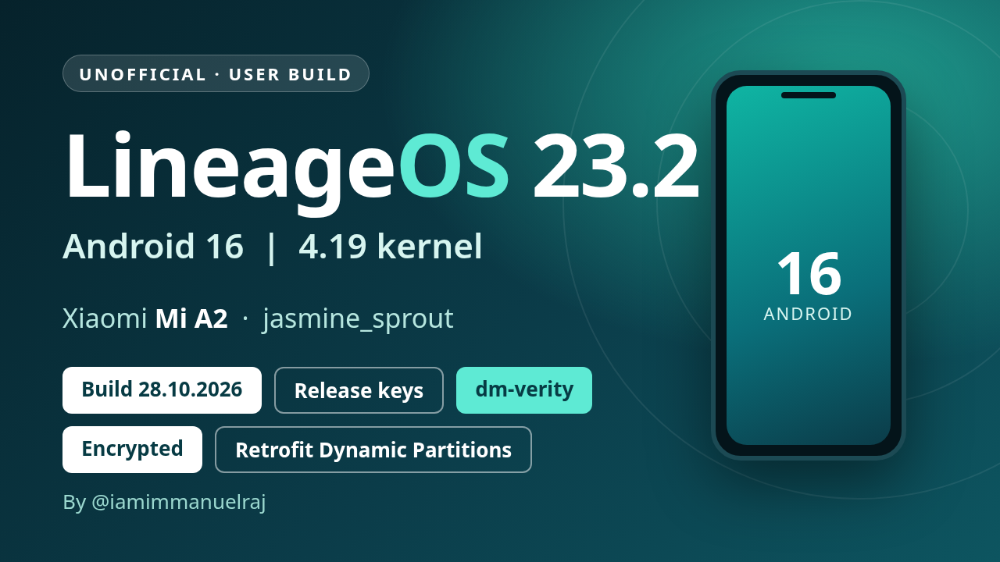

# LineageOS - Xiaomi Mi A2 (jasmine_sprout)

**[LineageOS ROM Source Code](https://github.com/LineageOS)** · [Changelog](CHANGELOG.md)

## Builds

| Version | Android | Build | Notes |
| --- | --- | --- | --- |
| [23.2](23.2/README.md) | 16 | **[28.10.2026](23.2/20261028/README.md)** (latest) | user, release-keys, dm-verity - Vanilla and GApps · Bluetooth fix, GApps zip installs again · [Release](https://github.com/iamimmanuelraj/AOSP/releases/tag/lineageos-23.2-jasmine_sprout-20261028) |
| [23.2](23.2/README.md) | 16 | [17.10.2026](23.2/20261017/README.md) | user, release-keys, dm-verity - Vanilla and GApps · Bluetooth crashes and the GApps zip fails (error 28), update to 28.10.2026 · [Release](https://github.com/iamimmanuelraj/AOSP/releases/tag/lineageos-23.2-jasmine_sprout-20261017) |
| [23.2](23.2/README.md) | 16 | [09.10.2026](23.2/20261009/README.md) | First test build · [Release](https://github.com/iamimmanuelraj/AOSP/releases/tag/lineageos-23.2-jasmine_sprout-20261009) |

## Device Source Codes - Mi A2

- **Kernel Tree:** [Kernel tree - Mi A2 (LineageOS SDM660 4.19, branch lineage-23.2)](https://github.com/iamimmanuelraj/android_kernel_xiaomi_sdm660/tree/lineage-23.2)

## Support

- [Report a bug or request a feature (GitHub issues)](https://github.com/iamimmanuelraj/AOSP/issues)

## Donate

- [Github Sponsor - Personal](https://github.com/sponsors/iamimmanuelraj/)
- **UPI [Personal]:** iamimmanuelraj@pingpay
- [PayPal - Personal](https://paypal.me/iamimmanuelraj?country.x=IN&locale.x=en_GB)

## Social

- [Github - Personal](https://github.com/iamimmanuelraj)
- [Twitter - Personal](https://twitter.com/iamimmanuelraj)
