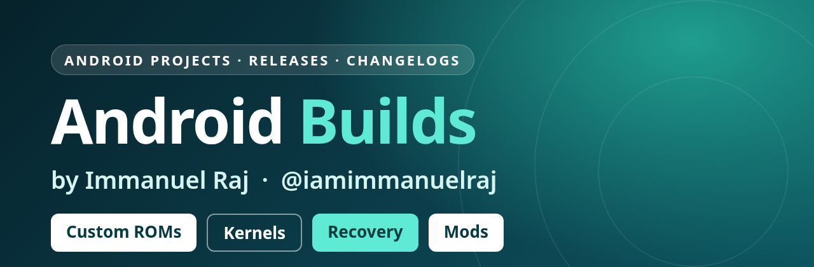

<div align="center">



**Everything I build for Android: custom ROMs, kernels, recoveries, mods, changelogs and flashing guides.**

[](https://github.com/iamimmanuelraj/AOSP/releases/latest)
[](https://github.com/iamimmanuelraj/AOSP/releases)
[](https://t.me/immanuelsfoundation)

</div>

---

## Devices

| Device | Codename | What's there | Latest |
| --- | --- | --- | --- |
| [**Xiaomi Mi A2**](DEVICES/xiaomi/jasmine_sprout/README.md) | `jasmine_sprout` | ROMs, kernels, recovery, flashing guides | [LineageOS · 17.10.2026](DEVICES/xiaomi/jasmine_sprout/ROMS/LineageOS/23.2/20261017/README.md) |
| [**Xiaomi Redmi Note 5 Pro**](DEVICES/xiaomi/whyred/README.md) | `whyred` | ROMs | PixelExtended (official) |

## How this repo is laid out

Everything is grouped by device, then by OS, then by version and build date:

```
DEVICES/<brand>/<codename>/
├── README.md                    device page: ROMs, kernels, recovery, guides
├── Standing_Instructions.md     rules and what to expect for this device
├── FLASHING/                    device-specific flashing guides
└── ROMS/<OS>/
    ├── README.md                all builds of this OS for the device
    ├── CHANGELOG.md
    └── <version>/<YYYYMMDD>/    one folder per release: notes, install steps, banner
```

Downloads are on the [Releases](https://github.com/iamimmanuelraj/AOSP/releases) page, tagged `<os>-<version>-<codename>-<YYYYMMDD>`.

## Mods

| Project | Devices | Status | Download |
| --- | --- | --- | --- |
| **Gboard Themer** | All devices | Own project · inactive | [Theme enabler zips](https://github.com/iamimmanuelraj/AOSP/releases/tag/Import-From-Sourceforge) · [Source](https://github.com/iamimmanuelraj/Gboardthemer) |

*My own SourceForge projects were removed for inactivity, so all builds from them now live in the [Import From SourceForge](https://github.com/iamimmanuelraj/AOSP/releases/tag/Import-From-Sourceforge) release.*

## Support the work

[](https://github.com/sponsors/iamimmanuelraj/)
[](https://paypal.me/iamimmanuelraj?country.x=IN&locale.x=en_GB)


## Find me

[](https://github.com/iamimmanuelraj)
[](https://twitter.com/iamimmanuelraj)
[](https://forum.xda-developers.com/m/immanuel-raj.9376270/)
[](https://t.me/iamimmanuelraj)
[](mailto:iamimmanuelraj@gmail.com)
